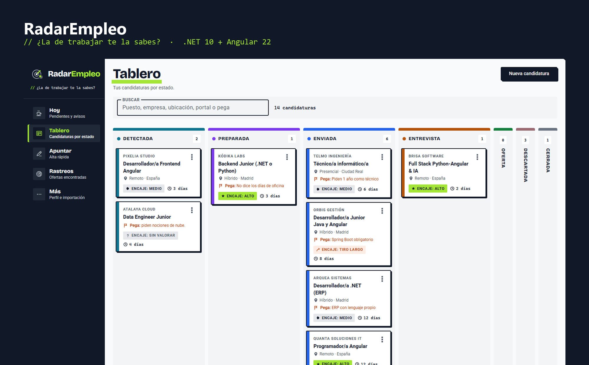
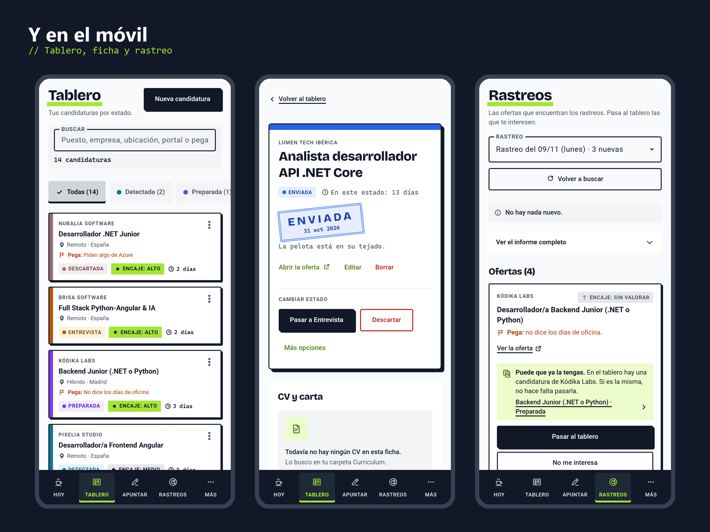
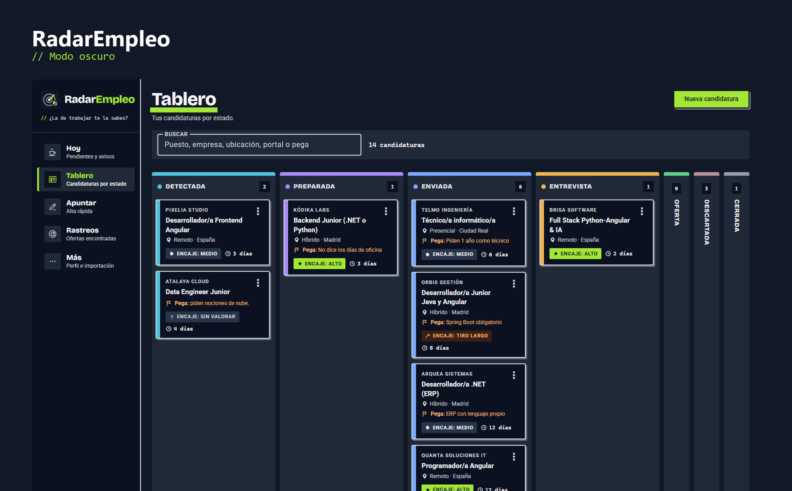

# RadarEmpleo

> ¿La de trabajar te la sabes?

Aplicación para llevar mi propia búsqueda de empleo: un tablero con las candidaturas por estado, la ficha de cada una con su historial y el CV que envié, y una bandeja donde caen las ofertas de la búsqueda de cada semana. La uso yo y es, a la vez, mi proyecto de portfolio con el stack que piden las ofertas a las que me presento.







_Las capturas son con datos de ejemplo._

## Qué hace

- **Tablero por estados**: Detectada, Preparada, Enviada, Entrevista, Oferta, Descartada y Cerrada. Las transiciones válidas las decide el dominio, no el front. Se mueve arrastrando o con el menú ⋮, y las columnas sin uso se pliegan para que todo quepa sin desplazamiento lateral.
- **Deshacer**: cualquier cambio de estado se puede deshacer durante 10 minutos desde el aviso o con Ctrl+Z. Vuelve exactamente a como estaba: fechas, motivo de descarte y seguimientos.
- **Ficha de candidatura**: historial de estados, notas, motivo de descarte y los documentos enviados (CV y carta), que se abren dentro de la propia ficha.
- **Importar del registro**: importa la tabla de candidaturas que llevaba a mano en Markdown, con vista previa y sin duplicar lo que ya está.
- **Rastreos**: lee los informes semanales de ofertas y deja pasar al tablero las que interesan. Si la empresa ya tiene una candidatura, avisa antes de duplicarla.
- **Perfil de búsqueda**: muestra los filtros y el stack con los que se valoran las ofertas.
- **Pensada para el móvil**: navegación inferior, zonas de toque de 48 px y textos sin jerga.
- **Diseño propio**: neobrutalismo con grises y lima, en modo claro y oscuro, con contraste AA. La guía está en [docs/DISENO.md](docs/DISENO.md).

## Stack

| Parte | Tecnología                                                                       |
| ----- | -------------------------------------------------------------------------------- |
| API   | ASP.NET Core Web API (.NET 10), ProblemDetails, OpenAPI                          |
| Datos | Entity Framework Core + SQLite, con migraciones                                  |
| Front | Angular 22 (standalone, signals, zoneless), Tailwind 4 y Angular Material        |
| Tests | xUnit en .NET y Vitest en Angular                                                |
| CI    | GitHub Actions: compila y pasa los tests de las dos partes en cada push a `main` |

## Arquitectura

```text
src/
  RadarEmpleo.Domain     entidades, estados y reglas de negocio puras (sin dependencias)
  RadarEmpleo.Data       DbContext, configuración de EF Core y migraciones
  RadarEmpleo.Services   casos de uso: candidaturas, importación, documentos, rastreos, perfil
  RadarEmpleo.Api        controladores, validación y errores como ProblemDetails
tests/
  RadarEmpleo.Tests      unitarios, de servicios contra SQLite y de la API con WebApplicationFactory
web/                     front en Angular, una carpeta por funcionalidad
docs/                    plan del proyecto por fases
```

Algunas decisiones que me parecen interesantes:

- **Concurrencia optimista**: si la misma candidatura se cambia desde dos sitios, el segundo recibe un 409 en vez de pisar el cambio.
- **Importación idempotente**: repetir la importación o el escaneo de rastreos no duplica nada.
- **Acceso a archivos acotado**: la app solo puede abrir CV y cartas de unas carpetas concretas. Comprueba rutas, enlaces duros y la ruta final del archivo ya abierto, para que nunca pueda servir otra cosa (por ejemplo, la carpeta con el DNI).
- **Solo en local**: la API solo acepta peticiones de `localhost` y la base de datos vive fuera del repositorio.

## Cómo arrancarla

Requisitos: .NET 10 SDK y Node 24.

1. Prepara una carpeta de prueba: copia `datos-ejemplo` a donde quieras y renombra dentro `registro-ejemplo.md` a `ofertas-enviadas.md` y `perfil-ejemplo.md` a `perfil-busqueda.md`, que son los nombres que lee la app.

2. Crea `src/RadarEmpleo.Api/appsettings.Local.json` (está en `.gitignore`) apuntando a esa carpeta:

    ```json
    {
        "RadarEmpleo": {
            "RutaBaseDatos": "%LOCALAPPDATA%\\RadarEmpleo\\radar.db",
            "CarpetaCurriculum": "C:\\ruta\\a\\tu\\carpeta-de-prueba"
        }
    }
    ```

3. Arranca la API (escucha en `http://localhost:5180` y crea la base de datos al empezar):

    ```bash
    dotnet run --project src/RadarEmpleo.Api
    ```

4. En otra terminal, arranca el front y abre `http://localhost:4200`:

    ```bash
    cd web
    npm ci
    npm start
    ```

## Tests

```bash
dotnet test RadarEmpleo.slnx
cd web && npx ng test --watch=false
```

## Estado

En desarrollo, por fases. Hechas: tablero y fichas, importación del registro, documentos, rastreos y perfil. Lo siguiente es la pantalla «Hoy» con recordatorios y, después, que la app prepare el CV adaptado a cada oferta y gestione el envío, con modo manual por defecto. El plan completo está en [docs/PLAN.md](docs/PLAN.md) y [docs/PLAN-AMPLIACION.md](docs/PLAN-AMPLIACION.md).

## Autor

Eduardo Lara Navarro · [GitHub](https://github.com/eduardolar) · [LinkedIn](https://www.linkedin.com/in/eduardo-lara-navarro-007138100)
