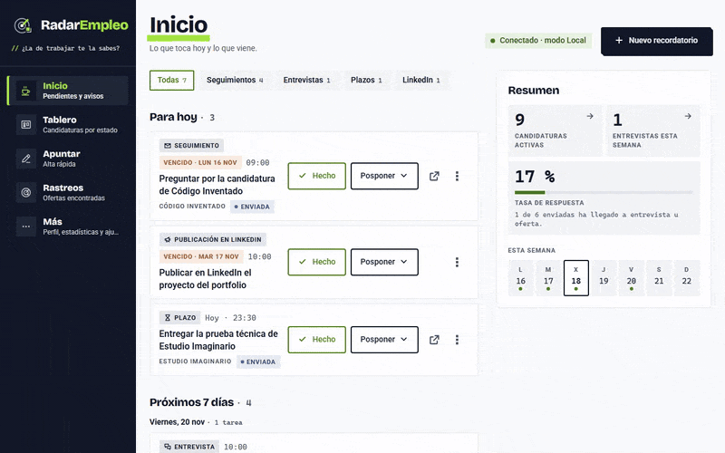
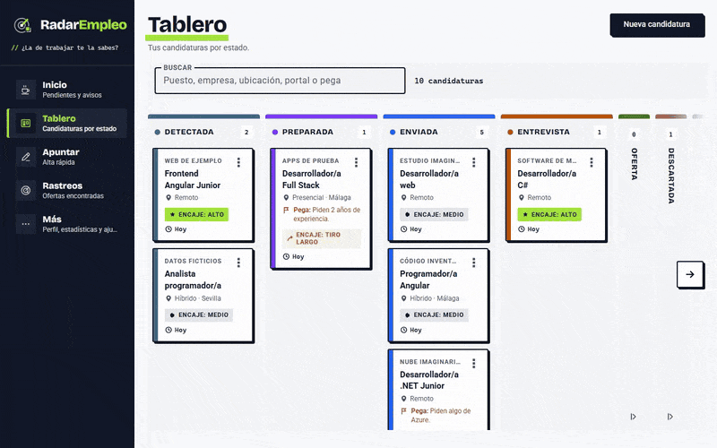
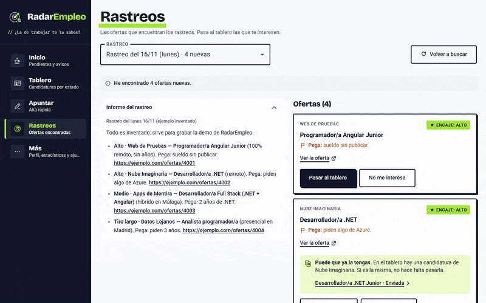
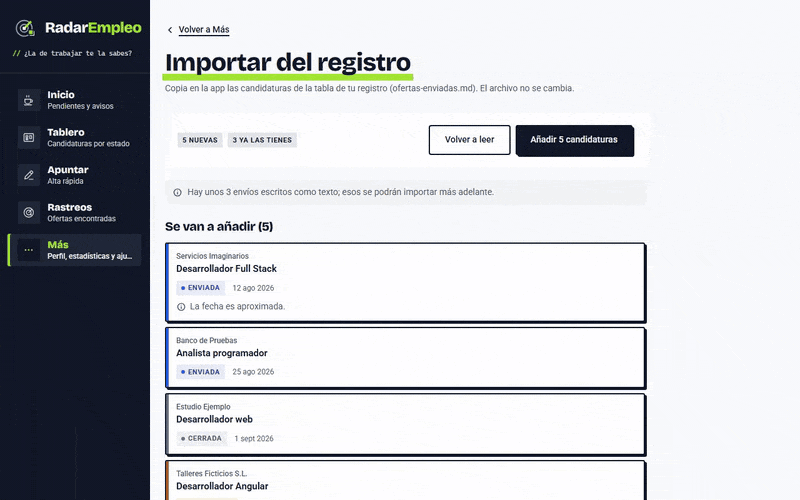
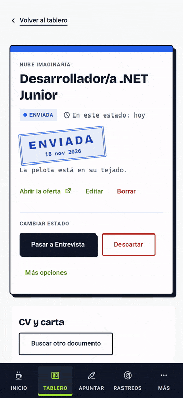

# RadarEmpleo

[](https://github.com/eduardolar/RadarEmpleo/actions/workflows/ci.yml)

> ¿La de trabajar te la sabes?

Aplicación para llevar mi propia búsqueda de empleo: un tablero con las candidaturas por estado, la ficha de cada una con su historial y el CV que envié, y una bandeja donde caen las ofertas de la búsqueda de cada semana. La uso yo y es, a la vez, mi proyecto de portfolio con el stack que piden las ofertas a las que me presento.

<h3 align="center">
  <a href="https://eduardolar.github.io/RadarEmpleo-web/">▶ Verla en 30 segundos: eduardolar.github.io/RadarEmpleo-web</a>
</h3>

## Cómo funciona

_Vídeos de la app real con datos inventados. También en MP4: [inicio](docs/demo/inicio.mp4), [tablero](docs/demo/tablero.mp4), [rastreos](docs/demo/radar.mp4), [importar](docs/demo/importar.mp4) y [móvil](docs/demo/movil.mp4)._

<table>
  <tr>
    <td width="50%" valign="top">
      
      <br><b>Inicio:</b> lo que toca hoy, con Hecho, Posponer y Deshacer.
    </td>
    <td width="50%" valign="top">
      
      <br><b>Tablero:</b> arrastrar a Entrevista y apuntarla con su hora; el seguimiento pendiente se cierra solo.
    </td>
  </tr>
  <tr>
    <td width="50%" valign="top">
      
      <br><b>Rastreos:</b> las ofertas de la semana pasan al tablero con un clic, y avisa si ya la tienes.
    </td>
    <td width="50%" valign="top">
      
      <br><b>Importar:</b> el registro que llevaba a mano en Markdown, con vista previa y sin duplicados.
    </td>
  </tr>
</table>

<p align="center">
  
  <br><b>En el móvil:</b> la ficha con su historial y el CV enviado, en modo claro y oscuro.
</p>

## Qué hace

- **Inicio**: arriba lo vencido y lo de hoy, con Hecho, Posponer y Deshacer; debajo, los próximos siete días y las candidaturas enviadas que siguen sin respuesta. Los recordatorios tienen tipo (seguimiento, entrevista, publicación de LinkedIn, plazo u otro) y, al pasar una candidatura a Entrevista, el seguimiento pendiente se cierra solo y la app ofrece apuntar la entrevista con la hora obligatoria.
- **Estadísticas**: candidaturas por estado, enviadas por semana, tasa de respuesta, días de media hasta la respuesta y motivos de descarte. Cada cifra se lee también como texto, sin depender del color.
- **Fechas en hora de Madrid**: probado con el cambio de hora de marzo, incluida la hora que ese día no existe.
- **Tablero por estados**: Detectada, Preparada, Enviada, Entrevista, Oferta, Descartada y Cerrada. Las transiciones válidas las decide el dominio, no el front. Se mueve arrastrando o con el menú ⋮, y las columnas sin uso se pliegan para que quepan más a la vista; si no caben todas, unas flechas desplazan el tablero.
- **Deshacer**: cualquier cambio de estado se puede deshacer durante 10 minutos desde el aviso o con Ctrl+Z. Vuelve exactamente a como estaba: fechas, motivo de descarte y seguimientos.
- **Ficha de candidatura**: historial de estados, notas, motivo de descarte y los documentos enviados (CV y carta), que se abren dentro de la propia ficha.
- **Importar del registro**: importa la tabla de candidaturas que llevaba a mano en Markdown, con vista previa y sin duplicar lo que ya está. Lo que apunté como texto, fuera de la tabla, lo lee Claude (ver [Con Claude](#con-claude)).
- **Rastreos**: lee los informes semanales de ofertas y deja pasar al tablero las que interesan. Si la empresa ya tiene una candidatura, avisa antes de duplicarla.
- **Perfil de búsqueda**: muestra los filtros y el stack con los que se valoran las ofertas.
- **Pensada para el móvil**: navegación inferior, zonas de toque de 48 px y textos sin jerga.
- **Diseño propio**: neobrutalismo con grises y lima, en modo claro y oscuro, con contraste AA. La guía está en [docs/DISENO.md](docs/DISENO.md).

## Con Claude

La app lanza [Claude Code](https://claude.com/claude-code) en el propio PC para dos tareas fijas. No hay ningún cuadro donde escribirle: cada tarea tiene su plantilla, y Claude propone y decido yo.

- **Analizar el encaje, desde la ficha**: «Analizar encaje con Claude» descarga la oferta, la compara con mi perfil de búsqueda y rellena el encaje, la pega y el análisis. Lo que hubiera antes se guarda en una nota. Si la oferta ya no está publicada, no gasta nada y me propone descartarla; nunca la descarta sola.
- **Extraer el texto libre del registro, en Importación**: buena parte de mi registro son frases sueltas, no filas de una tabla. «Extraer el texto libre con Claude» las lee por partes y las enseña junto a la tabla, cada una marcada como «Leída con Claude», con sus dudas aparte. No se añade nada hasta que pulso «Aplicar».
- **Agentes**: una página con las últimas tareas (hecha, en curso, no ha salido), con «Cancelar» y «Reintentar».
- **El uso, en Ajustes**: cuánto llevo usado hoy, como porcentaje de un tope diario, y la versión de Claude Code.

Cómo está acotado:

- **Solo desde el PC**: por la entrada del móvil, la API responde 403 a todo lo de agentes, y en el móvil y en la demo ni siquiera salen los botones.
- **El uso sale de la suscripción de Claude Code**, no de una clave de API: no se cobra aparte. Por eso la app habla de «uso estimado» y no de dinero.
- **Con límites**: una tarea a la vez, con tiempo máximo y tope de uso por tarea y por día.
- **Claude no toca nada**: en estas dos tareas va sin herramientas (no abre webs ni lee o escribe archivos). La oferta la descarga la app, con protección contra direcciones internas, y todo le llega como datos, no como órdenes. Su respuesta tiene que cumplir un esquema y se valida otra vez antes de guardarla.
- **Mis archivos, intactos**: la app calcula el hash del registro y del perfil antes y después de cada tarea, y avisa en rojo si alguno ha cambiado.

Los agentes vienen apagados. Se encienden con `"Agentes": { "Habilitado": true }` en `appsettings.Local.json` y necesitan Claude Code instalado (probado con la versión 2.1.185). Para probar las pantallas sin gastar hay un ejecutor falso con respuestas de ejemplo (`"Ejecutor": "Falso"`, que solo arranca con una base de datos que no sea la de por defecto).

## Stack

| Parte | Tecnología                                                                       |
| ----- | -------------------------------------------------------------------------------- |
| API   | ASP.NET Core Web API (.NET 10), ProblemDetails, OpenAPI                          |
| Datos | Entity Framework Core + SQLite, con migraciones                                  |
| Front | Angular 22 (standalone, signals, zoneless), Tailwind 4 y Angular Material        |
| Tests | xUnit en .NET y Vitest en Angular                                                |
| CI    | GitHub Actions: compila y pasa los tests de las dos partes en cada push a `main` |

## Arquitectura

```text
src/
  RadarEmpleo.Domain     entidades, estados y reglas de negocio puras (sin dependencias)
  RadarEmpleo.Data       DbContext, configuración de EF Core y migraciones
  RadarEmpleo.Services   casos de uso: candidaturas, importación, documentos, rastreos, perfil, agentes
  RadarEmpleo.Api        controladores, validación y errores como ProblemDetails
tests/
  RadarEmpleo.Tests      unitarios, de servicios contra SQLite y de la API con WebApplicationFactory
web/                     front en Angular, una carpeta por funcionalidad
prompts/                 plantillas y esquemas JSON de las tareas de Claude
docs/                    plan del proyecto por fases y guía de diseño
```

Algunas decisiones que me parecen interesantes:

- **Concurrencia optimista**: si la misma candidatura se cambia desde dos sitios, el segundo recibe un 409 en vez de pisar el cambio.
- **Importación idempotente**: repetir la importación o el escaneo de rastreos no duplica nada.
- **Acceso a archivos acotado**: la app solo puede abrir CV y cartas de unas carpetas concretas. Comprueba rutas, enlaces duros y la ruta final del archivo ya abierto, para que nunca pueda servir otra cosa (por ejemplo, la carpeta con el DNI).
- **Solo en local**: la API solo acepta peticiones de `localhost` y la base de datos vive fuera del repositorio.
- **El servidor no se fía del cliente**: al importar, el navegador solo manda el hash del registro que leyó y las filas elegidas; el servidor vuelve a leer el archivo y, si ha cambiado, responde 409 en vez de importar algo viejo.
- **Una cola para Claude**: las tareas pasan de una en una por una cola guardada en la base de datos, con un bloqueo compartido para no pisarse con otras sesiones de Claude Code. Los tests nunca lanzan un Claude de verdad: usan un ejecutor falso y un programa que lo simula.

## Cómo arrancarla

Requisitos: .NET 10 SDK y Node 24.

1. Prepara una carpeta de prueba: copia `datos-ejemplo` a donde quieras y renombra dentro `registro-ejemplo.md` a `ofertas-enviadas.md` y `perfil-ejemplo.md` a `perfil-busqueda.md`, que son los nombres que lee la app.

2. Crea `src/RadarEmpleo.Api/appsettings.Local.json` (está en `.gitignore`) apuntando a esa carpeta:

    ```json
    {
        "RadarEmpleo": {
            "RutaBaseDatos": "%LOCALAPPDATA%\\RadarEmpleo\\radar.db",
            "CarpetaCurriculum": "C:\\ruta\\a\\tu\\carpeta-de-prueba"
        }
    }
    ```

3. Arranca la API (escucha en `http://localhost:5180` y crea la base de datos al empezar):

    ```bash
    dotnet run --project src/RadarEmpleo.Api
    ```

4. En otra terminal, arranca el front y abre `http://localhost:4200`:

    ```bash
    cd web
    npm ci
    npm start
    ```

## Tests

```bash
dotnet test RadarEmpleo.slnx
cd web && npx ng test --watch=false
```

## Preparar y enviar (en desarrollo)

La siguiente parte del proyecto se encarga del trabajo repetitivo de cada candidatura (adaptar el CV y la carta a la oferta y rellenar el formulario). La idea no es mandar currículums en masa, sino ahorrarme tiempo en las ofertas que elijo yo:

- **Una a una**: decido yo a qué oferta me presento. La app no se presenta a nada por su cuenta.
- **CV y carta para esa oferta**: un agente los adapta y otro los revisa (que no haya nada inventado, que no queden restos de otra empresa y que quepan en una página). Antes de usarlos los leo yo.
- **El último clic es mío**: la app rellena el formulario y se para justo antes de enviar. Me enseña un resumen de lo que va a mandar y lo confirmo yo.
- **LinkedIn e InfoJobs, siempre a mano**: el modo automático es opcional y está desactivado por defecto. Solo existe para el correo y para webs de empresa sin cuenta, con un máximo de 3 envíos al día y nunca a la misma empresa dos veces en un mes. En LinkedIn e InfoJobs no existe.
- **Con límites**: tope de gasto al día, una tarea a la vez, y la app nunca modifica mis propios archivos del registro.

El diseño completo y sus salvaguardas están en [docs/PLAN-AMPLIACION.md](docs/PLAN-AMPLIACION.md).

## Estado

En desarrollo, por fases. Hechas: tablero y fichas, importación del registro, documentos, rastreos, perfil, la pantalla Inicio con recordatorios, estadísticas, ajustes y las dos primeras tareas con Claude (analizar el encaje y leer el texto libre del registro). Lo siguiente es lanzar el rastreo de ofertas desde la app y, después, que prepare el CV adaptado a cada oferta y ayude a enviarla (ver [Preparar y enviar](#preparar-y-enviar-en-desarrollo)). El plan completo está en [docs/PLAN.md](docs/PLAN.md) y [docs/PLAN-AMPLIACION.md](docs/PLAN-AMPLIACION.md).

## Autor

Eduardo Lara Navarro · [GitHub](https://github.com/eduardolar) · [LinkedIn](https://www.linkedin.com/in/eduardo-lara-navarro-007138100)
